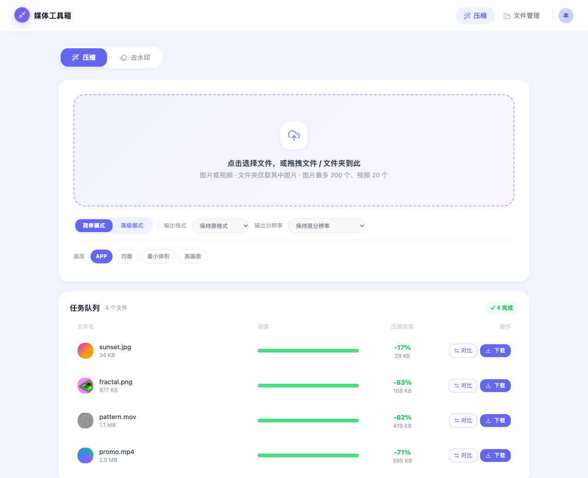
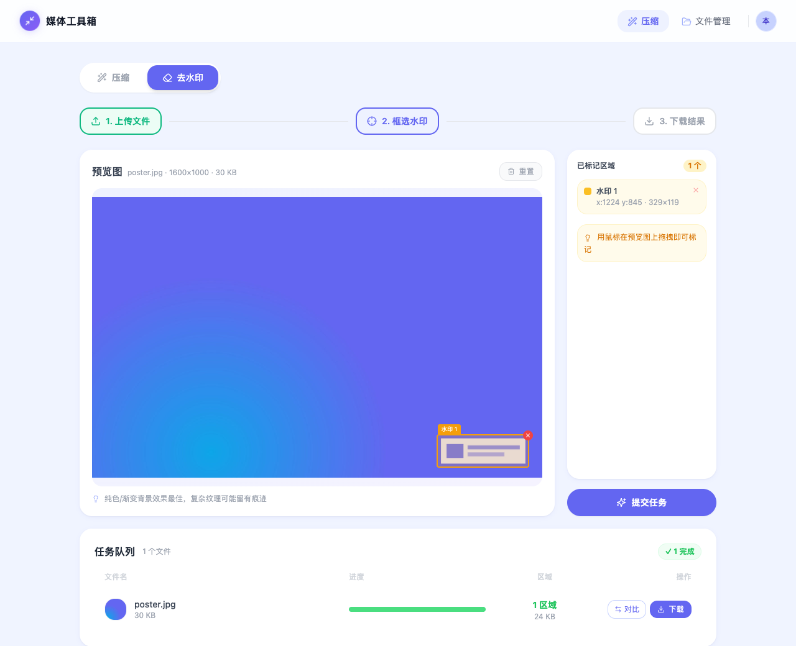
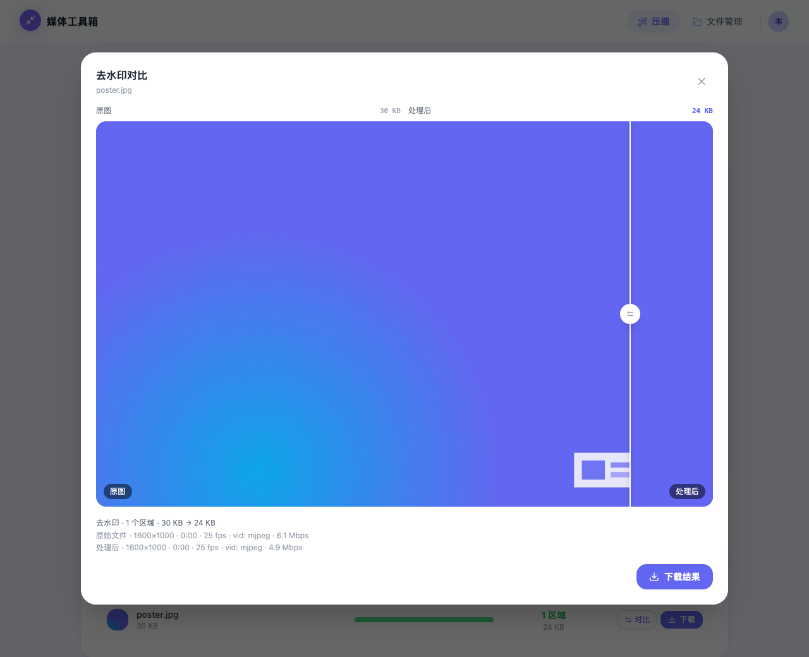
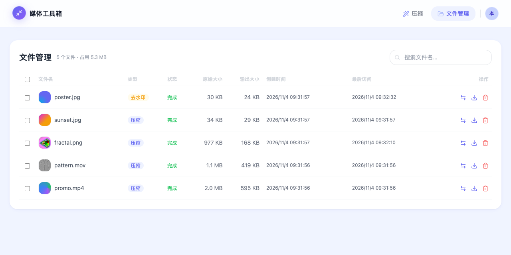

# media-compress

自托管的图片 / 视频压缩与去水印工具，基于 FFmpeg。文件只在你自己的机器或服务器上处理，不上传任何第三方服务。



- **压缩**：四档预设一键压缩，或高级模式自定画质、CRF、码率、帧率、分辨率与输出格式；支持批量上传和文件夹拖入
- **去水印**：在预览图上框选水印区域，用 FFmpeg `delogo` 滤镜按周边像素插值抹除，图片和视频都支持
- **对比与下载**：拖动滑块对比处理前后效果，单个下载或批量打包成 zip
- **文件管理**：查看全部任务、搜索、批量下载与删除，按容量和时间自动清理旧文件

| 框选水印 | 去水印前后对比 |
| --- | --- |
|  |  |



## 快速开始

### 方式一：Docker（推荐）

只需要安装 Docker，镜像内置带全部编码器的 FFmpeg：

```bash
git clone https://github.com/AI-Pocket-Verse/media-compress.git
cd media-compress
docker compose up -d --build
```

打开 <http://localhost:8080> 即可使用。数据库和上传、输出文件保存在 Docker 卷 `media-compress-data` 里，重建容器不会丢失。

- **升级**：`git pull && docker compose up -d --build`，启动时自动应用数据库迁移。
- **局域网访问**：默认只绑定本机 `127.0.0.1:8080`。要让其他设备访问，把 `docker-compose.yml` 里的端口改成 `"8080:4010"`，并在 `ALLOWED_HOSTS` 填本机的局域网 IP 或域名（见下方「安全提示」）。
- **其他配置**：在 `docker-compose.yml` 的 `environment` 里设置，可用项见下文「配置」。

### 方式二：源码运行

需要 Node.js ≥ 20.19（推荐 22 或 24）、pnpm 9 和 FFmpeg（安装方法见下文「FFmpeg 要求」）。

```bash
git clone https://github.com/AI-Pocket-Verse/media-compress.git
cd media-compress
pnpm install     # 安装依赖并生成 Prisma client
pnpm bootstrap   # 生成配置文件 api/.env.dev，并创建本地 SQLite 数据库
pnpm dev         # 同时启动 api（:4010）和 web（:5010）
```

打开 <http://localhost:5010> 即可使用。上传和处理结果存放在 `api/data/`，数据库在 `api/prisma/dev.db`。

> **安全提示**：默认是**本地单用户模式**，无需登录，所有任务归属同一个本地用户。为了防止恶意网页通过 DNS 重绑定或跨站请求读取、删除你的文件，本地模式只接受 Host 为 `localhost` / `127.0.0.1` / `[::1]` 的请求，其他访问返回 403 `host_not_allowed`。用局域网 IP 或域名访问时，把主机名加入 `ALLOWED_HOSTS`；加入后任何能访问到端口的人都能上传、下载和删除文件。对外提供服务请先接入登录（见「可选：多用户登录」）并放在反向代理之后。

## 使用说明

### 压缩

上传图片或视频（图片一次最多 200 个、视频 20 个；拖入文件夹时只取其中的图片），选好参数后点「开始压缩」。任务在服务端排队处理，完成后可以点「对比」查看效果，或直接下载。

简单模式的四档预设：

| 预设 | 图片 | 视频 |
| --- | --- | --- |
| APP | 画质 80，默认输出 webp（服务器 FFmpeg 不支持 webp 时改为 jpg） | H.264 CRF 23、30 fps，**去掉音轨**，适合 App 内的背景视频 |
| 均衡 | 画质 75 | CRF 23，保留音频 |
| 最小体积 | 画质 50 | CRF 35 |
| 高画质 | 画质 90 | CRF 18 |

高级模式可以单独设置图片画质，视频的 CRF、码率、帧率和音频处理（保留 / 重新编码 / 去掉）。分辨率只会缩小、不会放大，并保持原始宽高比。

压缩是有损重新编码：原文件已经压得很小，或者画面细节很多时，输出可能比原文件大，页面会标出「变大」，这种情况保留原文件即可。

### 去水印

切到「去水印」，上传文件后在预览图上拖拽框选水印，可以框多个区域（最多 50 个），然后点「提交任务」。

`delogo` 用区域周边的像素插值填充，纯色或渐变背景效果最好；背景纹理复杂时会留下模糊痕迹。

### 支持格式

| 类型 | 可上传 | 可输出 |
| --- | --- | --- |
| 图片 | jpg、png、webp、gif、bmp、tiff、heic、avif、ico 等 | jpg、png、webp、gif、bmp |
| 视频 | mp4、mov、avi、mkv、webm、flv、wmv、ts、m4v、3gp 等 | mp4、webm、mov、mkv、avi、m4v |

- 图片与视频不能互转；动图转 jpg / png / bmp 只取首帧。
- 视频选「保持原格式」时，ogv / wmv 改为输出 mp4。
- 视频输出统一为 8-bit yuv420p，保证浏览器能播放；HDR / 10-bit 源会损失色彩范围。

### 自动清理

每个用户的文件超过 5 GB 时，按最近访问时间清理旧文件，30 天内访问过的不会被清理；创建超过 180 天的文件无条件清理。阈值见下文「配置」。

## FFmpeg 要求

Docker 镜像已内置，源码运行时需要自行安装。不同输出格式依赖不同的编码器：

| 输出格式 | 需要的编码器 |
| --- | --- |
| 保持原格式、png、jpg、gif、bmp | 无额外要求 |
| mp4 / mov / mkv / m4v / avi | libx264 |
| webm | libvpx-vp9（音频用 libopus） |
| webp | libwebp |

- **macOS**：`brew install ffmpeg`。它不含 libwebp，页面上 webp 选项会置灰，其他功能都可用。需要输出 webp 时改装 `brew install ffmpeg-full`，它不会链接进 PATH，需在 `api/.env.dev` 里写绝对路径：
  ```
  FFMPEG_PATH=/opt/homebrew/opt/ffmpeg-full/bin/ffmpeg
  FFPROBE_PATH=/opt/homebrew/opt/ffmpeg-full/bin/ffprobe
  ```
  Intel Mac 把 `/opt/homebrew` 换成 `/usr/local`；Homebrew 已不再为 Intel Mac 提供预编译包，`ffmpeg-full` 会从源码编译，耗时可能达数小时。
- **Debian / Ubuntu**：`sudo apt install ffmpeg`，官方包已包含上表全部编码器。

api 启动时检测一次，日志里打印 `ffmpeg: ok` 或不支持的输出格式。`ffmpeg` / `ffprobe` 无法运行时（未安装、动态库缺失等），页面顶部显示提示，上传接口返回 503 `ffmpeg_unavailable`；修好后约 1 分钟内自动恢复，刷新页面即可，无需重启。

## 配置

api 用 Node 原生的 `--env-file` 加载配置：`pnpm dev` 读 `api/.env.dev`，`pnpm start` 读 `api/.env.prod`。两者都不入库，模板是 [`api/.env.example`](api/.env.example)，每项都有注释。常用项：

| 变量 | 默认 | 说明 |
| --- | --- | --- |
| `HOST` / `PORT` | `127.0.0.1` / `4010` | api 监听地址；见上方安全提示 |
| `ALLOWED_HOSTS` | 空 | 本地模式下额外允许的访问主机名（逗号分隔，不带端口），默认只允许本机；`*` 关闭校验（不推荐）。配置了 `WHOAMI_URL` 时不生效 |
| `DATABASE_URL` | — | SQLite 路径，相对路径以 `api/prisma/` 为基准；生产建议写绝对路径 |
| `BASE_DIR` | `./data` | 上传、输出、缩略图、清理日志的根目录；`uploads/`、`outputs/` 固定在其下，缩略图和清理日志可用 `THUMBNAIL_DIR` / `CLEANER_LOG` 单独指定 |
| `FFMPEG_PATH` / `FFPROBE_PATH` | `ffmpeg` / `ffprobe` | FFmpeg 可执行文件 |
| `WORKER_COUNT` | `1` | 同时处理的任务数 |
| `MAX_UPLOAD_BYTES` | 2 GB | 单文件上传上限 |
| `FFMPEG_TIMEOUT_MS` | 600000 | 单个任务的 FFmpeg 超时（毫秒），超时任务标记失败并清除半成品 |
| `MAX_STORAGE_BYTES` / `MAX_AGE_DAYS` | 5 GB / 180 天 | 自动清理阈值。容量是每个用户的软限制：`PROTECTION_DAYS` 内访问过的任务不会因超容量被清理 |
| `PROTECTION_DAYS` / `LRU_CLEANUP_BYTES` | 30 天 / 1 GB | 超容量时的保护期，以及单次清理的目标释放量 |
| `TRUST_PROXY` | `loopback` | 信任的反向代理地址（Fastify `trustProxy`），限流按真实客户端 IP 分桶。同机 nginx 反代或不经反代直连都无需改；不要设为 `true`，也不支持跳数（数字会启动报错），请写代理的 IP / 网段 |
| `WEB_DIST_DIR` | 未设置 | 设置后 api 直接托管前端构建产物（如 `../web/dist`），单端口即可使用；Docker 镜像已设置，nginx 部署留空 |
| `CORS_ORIGINS` | 空 | 同源部署（Vite 代理 / nginx）留空；跨域直连时填逗号分隔的来源 |
| `WHOAMI_URL` | 未设置 | 设置后启用多用户登录，见下节 |

## 可选：多用户登录

不设置时为本地单用户模式。需要多人使用、按人隔离文件时，可以接入配套的飞书统一登录服务 feishu-sso（即将开源），也可以对接你自己的登录服务，只要它满足下面的 whoami 约定：

- 登录态放在同域名的 `sso_session` cookie 里；
- api 带着这个 cookie 请求 `WHOAMI_URL`：已登录返回 200 和 `{"authenticated": true, "user": {...}, "session": {...}}`，未登录返回 `{"authenticated": false}` 或 4xx；5xx 和超时按「登录服务暂不可用」处理，返回 503 `auth_unavailable`，不会把用户登出。字段定义见 [`packages/auth-core/src/index.ts`](packages/auth-core/src/index.ts)。

接入步骤（两端需同时配置，只配一端时前后端对「当前用户」的判断会不一致）：

1. 部署登录服务，并让反向代理把同一域名下的 `/auth/*` 转发给它（登录 cookie 依赖同源）。
2. api 设置 `WHOAMI_URL`，指向登录服务的 whoami 接口，例如 `http://127.0.0.1:4020/api/whoami`。
3. web 构建时设置 `VITE_SSO_BASE=/auth`（可写在 `web/.env.local`；Docker 用构建参数 `docker compose build --build-arg VITE_SSO_BASE=/auth`）。

## 部署

最简单的是上面的 Docker 方式。不用 Docker 时，`deploy/` 提供 systemd 与 nginx 模板（单机部署，nginx 托管前端静态文件并反代 api）：

```bash
git clone https://github.com/AI-Pocket-Verse/media-compress.git /opt/media-compress
cd /opt/media-compress
pnpm install && pnpm build
cp api/.env.example api/.env.prod   # 改为 NODE_ENV=production，并把 DATABASE_URL / BASE_DIR 设为绝对路径
pnpm --filter @media-compress/api db:migrate:prod

sudo cp deploy/systemd.service.template /etc/systemd/system/media-compress.service
sudo sed -i 's|__INSTALL_DIR__|/opt/media-compress|; s|__SERVICE_USER__|www-data|' /etc/systemd/system/media-compress.service
sudo systemctl daemon-reload && sudo systemctl enable --now media-compress

sudo cp deploy/nginx.conf.template /etc/nginx/sites-available/media-compress
sudo sed -i 's|__INSTALL_DIR__|/opt/media-compress|; s|__SERVER_NAME__|media.example.com|' /etc/nginx/sites-available/media-compress
sudo ln -sf /etc/nginx/sites-available/media-compress /etc/nginx/sites-enabled/ && sudo nginx -t && sudo systemctl reload nginx
```

- **升级**：`git pull && pnpm install && pnpm build && pnpm --filter @media-compress/api db:migrate:prod`，然后 `sudo systemctl restart media-compress`。
- **本地模式**（未接入登录）：要把 `__SERVER_NAME__` 对应的域名加入 `ALLOWED_HOSTS`，否则请求会被 403 拒绝。
- **反向代理与限流**：nginx 模板把 `X-Forwarded-For` 设为 `$remote_addr`（覆盖而不是追加），配合默认的 `TRUST_PROXY=loopback`，客户端无法伪造来源 IP 绕过限流。api 不在本机或前面还有一层代理时，把 `TRUST_PROXY` 改成实际代理的地址或网段。
- **数据库备份**：`deploy/backup-dev-db.sh`（去重 + 分级保留的 SQLite 快照）、`deploy/db-audit.sh`（查看快照）、`deploy/db-restore.sh`（恢复快照），通过 `BACKUP_DB` / `BACKUP_DIR` 指定路径。

## 开发

技术栈：Fastify + Prisma（SQLite）后端，React + Vite + Tailwind 前端，pnpm workspace 管理。

| 命令 | 作用 |
| --- | --- |
| `pnpm dev` | 本地开发（web 通过 Vite 代理访问 api） |
| `pnpm build` | 构建 api（`api/dist`）和 web（`web/dist`） |
| `pnpm typecheck` | 全部包类型检查 |
| `pnpm test` | 全部单元测试（本机装有 FFmpeg 时会额外跑真实转码测试） |
| `pnpm --filter @media-compress/api db:migrate` | 修改 `api/prisma/schema.prisma` 后生成并应用迁移 |

```
api/          Fastify 后端：上传、任务队列、FFmpeg 处理、下载与自动清理
web/          React 前端
packages/     api 与 web 共用的小工具包（登录客户端、HTTP 客户端、日志、Tailwind 预设等）
deploy/       systemd / nginx 模板与 SQLite 运维脚本
docs/         README 截图
Dockerfile    单容器镜像（api 同时托管前端）
```

## 安全

发现安全问题请不要公开提 issue，通过 GitHub 的私密漏洞报告提交，详见 [SECURITY.md](SECURITY.md)。

## License

[MIT](LICENSE)
