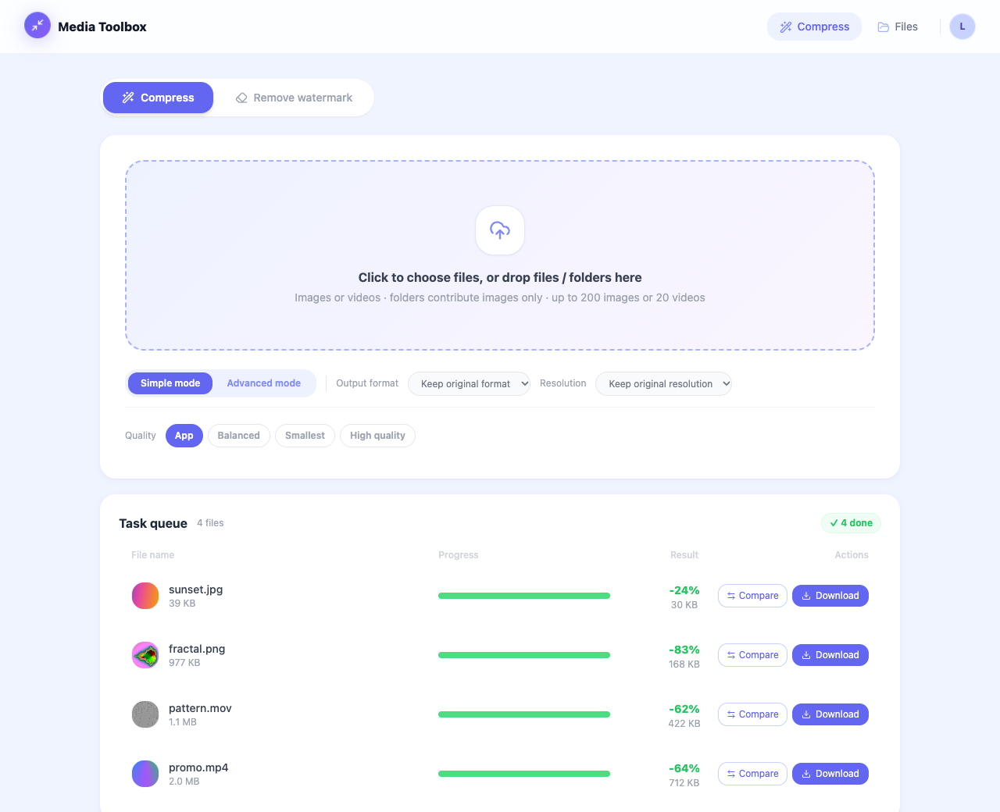
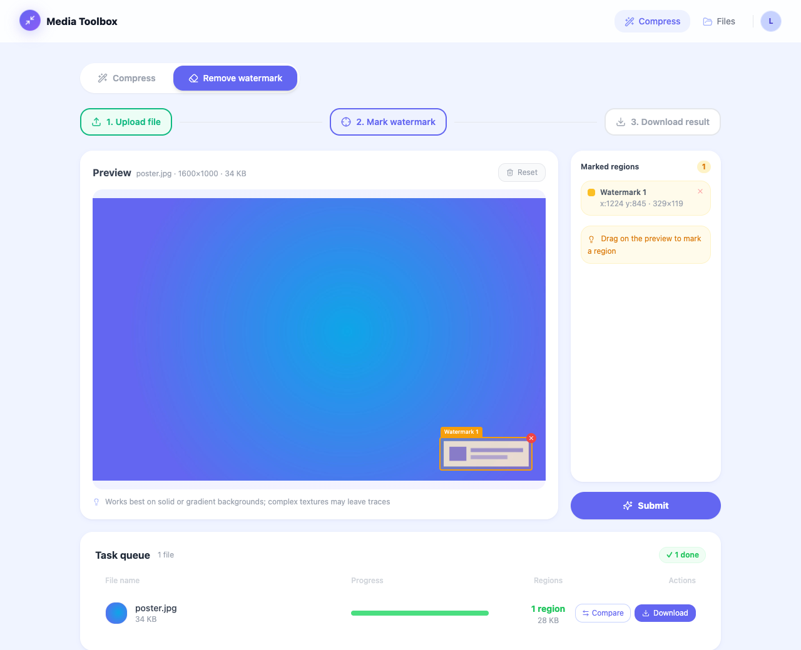
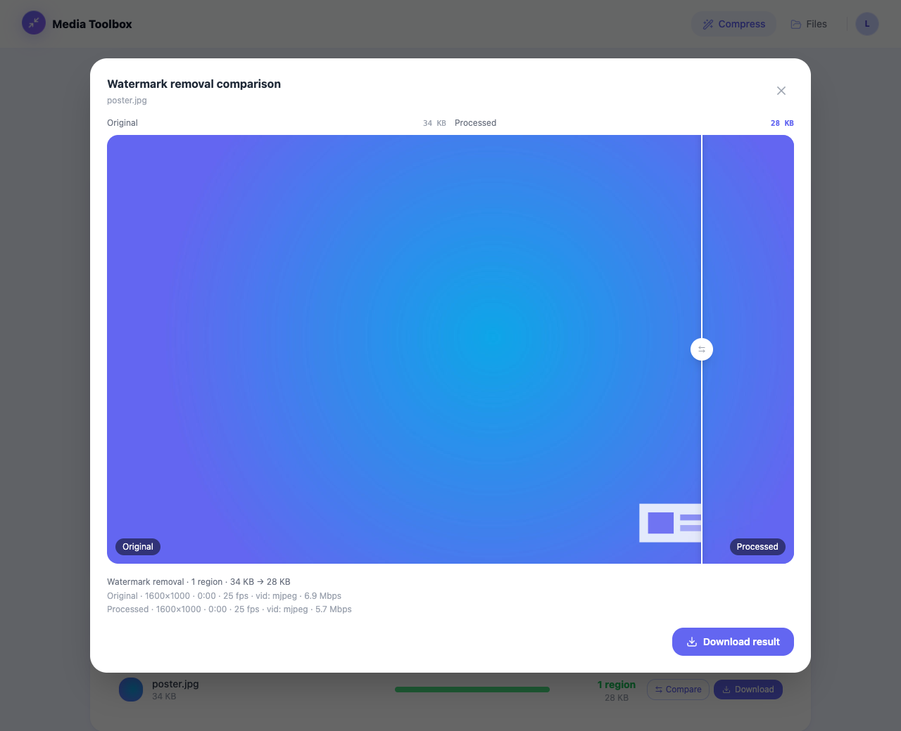
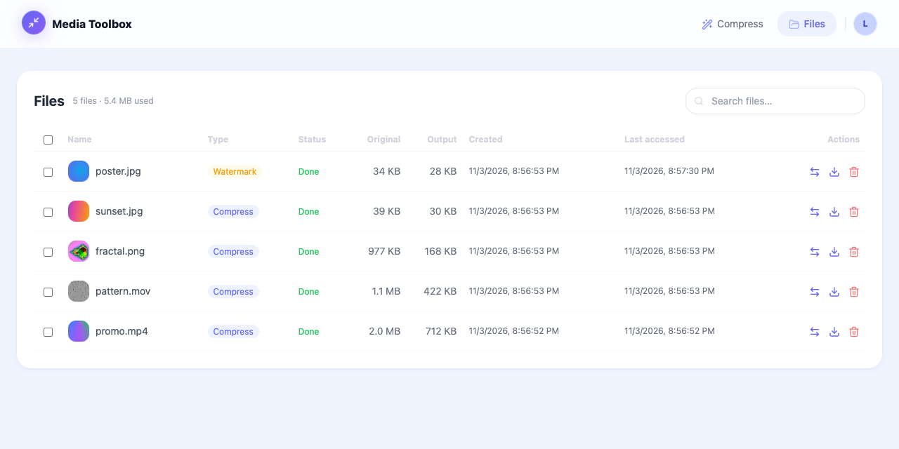

# media-compress

English | [简体中文](README-CN.md)

A self-hosted image / video compression and watermark removal tool built on FFmpeg. Files are processed only on your own machine or server and are never uploaded to any third-party service.



- **Compress**: one-click compression with four presets, or Advanced mode to customize quality, CRF, bitrate, frame rate, resolution and output format; supports batch upload and dragging in folders
- **Remove watermark**: draw a box around the watermark on the preview, and the FFmpeg `delogo` filter erases it by interpolating from the surrounding pixels; works for both images and videos
- **Compare and download**: drag a slider to compare before and after, then download files one by one or as a zip archive
- **Files**: view all tasks, search, bulk download and delete, with old files cleaned up automatically by storage size and age
- **Bilingual (Chinese / English)**: the UI follows the system language by default and can be switched manually in Settings

| Selecting the watermark | Before / after watermark removal |
| --- | --- |
|  |  |



## Quick start

### Option 1: Docker (recommended)

All you need is Docker. The image bundles FFmpeg with all required encoders:

```bash
git clone https://github.com/AI-Pocket-Verse/media-compress.git
cd media-compress
docker compose up -d --build
```

Open <http://localhost:8080> to use it. The database and the uploaded and output files are stored in the Docker volume `media-compress-data`, so they survive container rebuilds.

- **Upgrade**: `git pull && docker compose up -d --build`. Database migrations are applied automatically on startup.
- **LAN access**: by default it binds only to the local `127.0.0.1:8080`. To let other devices connect, change the port in `docker-compose.yml` to `"8080:4010"` and put the machine's LAN IP or domain name in `ALLOWED_HOSTS` (see "Security notice" below).
- **Other settings**: set them under `environment` in `docker-compose.yml`; see "Configuration" below for the available options.

### Option 2: Run from source

Requires Node.js >= 20.19 (22 or 24 recommended), pnpm 9 and FFmpeg (see "FFmpeg requirements" below for installation).

```bash
git clone https://github.com/AI-Pocket-Verse/media-compress.git
cd media-compress
pnpm install     # install dependencies and generate the Prisma client
pnpm bootstrap   # generate the config file api/.env.dev and create the local SQLite database
pnpm dev         # start both api (:4010) and web (:5010)
```

Open <http://localhost:5010> to use it. Uploads and results are stored in `api/data/`, and the database is at `api/prisma/dev.db`.

> **Security notice**: the default is **local single-user mode**: no login is required and all tasks belong to the same local user. To keep malicious web pages from reading or deleting your files through DNS rebinding or cross-site requests, local mode only accepts requests whose Host is `localhost` / `127.0.0.1` / `[::1]`; any other request gets a 403 `host_not_allowed`. When accessing it through a LAN IP or a domain name, add that hostname to `ALLOWED_HOSTS`; once added, anyone who can reach the port can upload, download and delete files. Before exposing the service publicly, set up login first (see "Optional: multi-user login") and put it behind a reverse proxy.

## Usage

### Compress

Upload images or videos (up to 200 images or 20 videos at a time; when you drag in a folder, only the images in it are taken), choose your settings, then click "Start compressing". Tasks are queued and processed on the server. When one finishes, click "Compare" to check the result, or download it directly.

The four presets in Simple mode:

| Preset | Image | Video |
| --- | --- | --- |
| App | Quality 80, outputs webp by default (falls back to jpg if the server's FFmpeg does not support webp) | H.264 CRF 23, 30 fps, **audio track removed**, suited to background videos inside apps |
| Balanced | Quality 75 | CRF 23, audio kept |
| Smallest | Quality 50 | CRF 35 |
| High quality | Quality 90 | CRF 18 |

Advanced mode lets you set image quality on its own, plus the video CRF, bitrate, frame rate and audio handling (keep / re-encode / remove). Resolution can only be reduced, never enlarged, and the original aspect ratio is preserved.

Compression is lossy re-encoding: if the original is already very small, or the picture has a lot of detail, the output may be larger than the original. The page then marks it "Larger", and you can simply keep the original file.

### Remove watermark

Switch to "Remove watermark", upload a file, drag on the preview to draw a box around the watermark (you can draw multiple regions, up to 50), then click "Submit".

`delogo` fills the region by interpolating from the surrounding pixels. It works best on solid-color or gradient backgrounds; on complex textured backgrounds it leaves blurry traces.

### Supported formats

| Type | Upload | Output |
| --- | --- | --- |
| Image | jpg, png, webp, gif, bmp, tiff, heic, avif, ico, etc. | jpg, png, webp, gif, bmp |
| Video | mp4, mov, avi, mkv, webm, flv, wmv, ts, m4v, 3gp, etc. | mp4, webm, mov, mkv, avi, m4v |

- Images and videos cannot be converted into each other; converting an animated image to jpg / png / bmp keeps only the first frame.
- When a video uses "Keep original format", ogv / wmv are output as mp4.
- Video output is always 8-bit yuv420p so that browsers can play it; HDR / 10-bit sources lose some color range.

### Automatic cleanup

When a user's files exceed 5 GB, old files are cleaned up by last access time, and files accessed within the last 30 days are not cleaned up; files created more than 180 days ago are cleaned up unconditionally. See "Configuration" below for the thresholds.

## FFmpeg requirements

The Docker image already bundles it; when running from source you need to install it yourself. Different output formats depend on different encoders:

| Output format | Required encoder |
| --- | --- |
| Keep original format, png, jpg, gif, bmp | No extra requirements |
| mp4 / mov / mkv / m4v / avi | libx264 |
| webm | libvpx-vp9 (libopus for audio) |
| webp | libwebp |

- **macOS**: `brew install ffmpeg`. It does not include libwebp, so the webp option is greyed out on the page; everything else works. If you need webp output, install `brew install ffmpeg-full` instead. It is not linked into PATH, so write the absolute paths in `api/.env.dev`:
  ```
  FFMPEG_PATH=/opt/homebrew/opt/ffmpeg-full/bin/ffmpeg
  FFPROBE_PATH=/opt/homebrew/opt/ffmpeg-full/bin/ffprobe
  ```
  On an Intel Mac, replace `/opt/homebrew` with `/usr/local`; Homebrew no longer provides prebuilt bottles for Intel Macs, so `ffmpeg-full` is built from source, which can take several hours.
- **Debian / Ubuntu**: `sudo apt install ffmpeg`. The official package already includes all the encoders in the table above.

The api checks once at startup and prints `ffmpeg: ok` or the unsupported output formats in the log. When `ffmpeg` / `ffprobe` cannot run (not installed, missing shared libraries, etc.), the page shows a notice at the top and the upload endpoints return 503 `ffmpeg_unavailable`; after you fix it, it recovers automatically within about 1 minute, just refresh the page, no restart needed.

## Configuration

The api loads its configuration with Node's native `--env-file`: `pnpm dev` reads `api/.env.dev`, and `pnpm start` reads `api/.env.prod`. Neither is committed to the repository; the template is [`api/.env.example`](api/.env.example), with a comment on every option. Common options:

| Variable | Default | Description |
| --- | --- | --- |
| `HOST` / `PORT` | `127.0.0.1` / `4010` | Address the api listens on; see the security notice above |
| `ALLOWED_HOSTS` | empty | Extra hostnames allowed in local mode (comma-separated, without port); by default only the local machine is allowed; `*` disables the check (not recommended). Has no effect when `WHOAMI_URL` is configured |
| `DATABASE_URL` | - | SQLite path; a relative path is resolved against `api/prisma/`; an absolute path is recommended in production |
| `BASE_DIR` | `./data` | Root directory for uploads, outputs, thumbnails and cleanup logs; `uploads/` and `outputs/` are fixed beneath it, while thumbnails and cleanup logs can be placed separately with `THUMBNAIL_DIR` / `CLEANER_LOG` |
| `FFMPEG_PATH` / `FFPROBE_PATH` | `ffmpeg` / `ffprobe` | FFmpeg executables |
| `WORKER_COUNT` | `1` | Number of tasks processed concurrently |
| `MAX_UPLOAD_BYTES` | 2 GB | Upload size limit per file |
| `FFMPEG_TIMEOUT_MS` | 600000 | FFmpeg timeout per task (milliseconds); a task that times out is marked failed and its partial output is removed |
| `MAX_STORAGE_BYTES` / `MAX_AGE_DAYS` | 5 GB / 180 days | Automatic cleanup thresholds. The storage limit is a soft limit per user: tasks accessed within `PROTECTION_DAYS` are not cleaned up for exceeding it |
| `PROTECTION_DAYS` / `LRU_CLEANUP_BYTES` | 30 days / 1 GB | Protection period when over the storage limit, and the amount to free in a single cleanup |
| `TRUST_PROXY` | `loopback` | Trusted reverse proxy addresses (Fastify `trustProxy`); rate limiting buckets by the real client IP. No change is needed for a same-host nginx reverse proxy or for direct connections without a proxy; do not set it to `true`, and hop counts are not supported (a number makes startup fail), so write the proxy's IP / subnet |
| `WEB_DIST_DIR` | unset | When set, the api serves the built frontend directly (e.g. `../web/dist`), so a single port is enough; already set in the Docker image, leave empty for nginx deployments |
| `CORS_ORIGINS` | empty | Leave empty for same-origin deployments (Vite proxy / nginx); for direct cross-origin access, enter comma-separated origins |
| `WHOAMI_URL` | unset | When set, enables multi-user login; see the next section |

## Optional: multi-user login

When not set, it runs in local single-user mode. If several people need to use it and their files must be isolated per person, connect a login service. The project is written against the API of the companion Feishu (Lark) SSO service [feishu-sso](https://github.com/AI-Pocket-Verse/feishu-sso); you can also implement a compatible login service yourself, following "Login service API" below.

### Setup

Configure both sides together; if only one side is configured, the frontend and backend will disagree about who the current user is.

1. Deploy the login service and have the reverse proxy forward `/auth/*` on the same domain to it (the login cookie depends on same-origin).
2. Set `WHOAMI_URL` for the api, pointing to the login service's whoami endpoint, for example `http://127.0.0.1:4020/api/whoami`.
3. Set `VITE_SSO_BASE=/auth` when building web (it can go in `web/.env.local`; with Docker, use the build argument `docker compose build --build-arg VITE_SSO_BASE=/auth`).

### Login service API

Paths below are relative to the login service root; with the setup above, the browser requests addresses like `/auth/api/whoami`.

| Endpoint | Called by | Description |
| --- | --- | --- |
| `GET /api/whoami` | Browser (with cookie), api | Returns the current login state; format below |
| `GET /login?return_to=<url>` | Browser redirect | Login page. Signed-out users clicking "Start compressing" or "Submit" are sent here, then back to `return_to` after signing in |
| `GET /api/feishu/authorize?return_to=<url>&remember_me=1` | Browser redirect | Starts authorization directly. Signed-out users clicking "Sign in" (top right) or the upload area are sent here, then back to `return_to` |
| `POST /api/logout` | Browser (with cookie) | Signs out |

`/api/feishu/authorize` keeps the path name used by feishu-sso. If your service uses different paths, override the defaults by passing `whoamiPath`, `loginPath`, `directLoginPath` or `logoutPath` in the `AuthProvider` config in `web/src/main.tsx`.

**Session and whoami**

- The session lives in an `sso_session` cookie on the same domain; the browser sends it automatically with the requests above.
- The api forwards only the `sso_session` cookie to `WHOAMI_URL` (header `Cookie: sso_session=<value>`) with a 5-second timeout; signed-in results are cached per session for 5 seconds.
- When signed in, return 200:

  ```json
  {
    "authenticated": true,
    "user": { "id": "u_123", "open_id": "ou_123", "name": "Alice", "last_login_at": "2026-01-01T00:00:00Z" },
    "session": { "id": "s_123", "user_id": "u_123", "remember_me": true, "expires_at": "2026-02-01T00:00:00Z", "last_seen_at": "2026-01-01T00:00:00Z" }
  }
  ```

  When signed out, also return 200 with `{"authenticated": false}`. The api treats a 4xx as signed out too, but the browser only trusts 200 and will not sign out on a 4xx.

**Field requirements**

- Every field in the example is required; times are ISO 8601. A response with missing or mistyped fields is treated as signed out.
- `user.id` decides who owns each file and must never change; if you have no `open_id` concept, use the same value as `id`.
- Optional fields: `avatar_url` (shown as the avatar when set), `email`, `mobile`, `union_id`, `en_name`, `avatar_thumb`, `tenant_key`. See [`packages/auth-core/src/index.ts`](packages/auth-core/src/index.ts) for the full definition.
- Once `session.expires_at` has passed, the api asks whoami again even within the cache window.

**Failure handling**

- When the api's whoami request returns 5xx, times out or cannot connect, it is treated as "login service temporarily unavailable": the api returns 503 `auth_unavailable` and does not sign the user out.
- When the browser's whoami request returns anything other than 200, the current login state is kept; it retries when the tab becomes visible again.

## Deployment

The simplest way is the Docker setup above. Without Docker, `deploy/` provides systemd and nginx templates (single-host deployment, where nginx serves the static frontend files and reverse-proxies the api):

```bash
git clone https://github.com/AI-Pocket-Verse/media-compress.git /opt/media-compress
cd /opt/media-compress
pnpm install && pnpm build
cp api/.env.example api/.env.prod   # set NODE_ENV=production, and make DATABASE_URL / BASE_DIR absolute paths
pnpm --filter @media-compress/api db:migrate:prod

sudo cp deploy/systemd.service.template /etc/systemd/system/media-compress.service
sudo sed -i 's|__INSTALL_DIR__|/opt/media-compress|; s|__SERVICE_USER__|www-data|' /etc/systemd/system/media-compress.service
sudo systemctl daemon-reload && sudo systemctl enable --now media-compress

sudo cp deploy/nginx.conf.template /etc/nginx/sites-available/media-compress
sudo sed -i 's|__INSTALL_DIR__|/opt/media-compress|; s|__SERVER_NAME__|media.example.com|' /etc/nginx/sites-available/media-compress
sudo ln -sf /etc/nginx/sites-available/media-compress /etc/nginx/sites-enabled/ && sudo nginx -t && sudo systemctl reload nginx
```

- **Upgrade**: `git pull && pnpm install && pnpm build && pnpm --filter @media-compress/api db:migrate:prod`, then `sudo systemctl restart media-compress`.
- **Local mode** (login not set up): add the domain name for `__SERVER_NAME__` to `ALLOWED_HOSTS`, otherwise requests are rejected with 403.
- **Reverse proxy and rate limiting**: the nginx template sets `X-Forwarded-For` to `$remote_addr` (overwriting rather than appending). Together with the default `TRUST_PROXY=loopback`, clients cannot spoof their source IP to get around rate limiting. If the api is not on the same host, or there is another proxy layer in front, change `TRUST_PROXY` to the actual proxy's address or subnet.
- **Database backup**: `deploy/backup-dev-db.sh` (SQLite snapshots with deduplication and tiered retention), `deploy/db-audit.sh` (inspect snapshots), `deploy/db-restore.sh` (restore a snapshot); set paths through `BACKUP_DB` / `BACKUP_DIR`.

## Development

Tech stack: Fastify + Prisma (SQLite) backend, React + Vite + Tailwind frontend, managed as a pnpm workspace.

| Command | Purpose |
| --- | --- |
| `pnpm dev` | Local development (web reaches the api through the Vite proxy) |
| `pnpm build` | Build the api (`api/dist`) and web (`web/dist`) |
| `pnpm typecheck` | Type-check all packages |
| `pnpm test` | All unit tests (extra real-transcoding tests run when FFmpeg is installed locally) |
| `pnpm --filter @media-compress/api db:migrate` | Generate and apply a migration after changing `api/prisma/schema.prisma` |

```
api/          Fastify backend: uploads, task queue, FFmpeg processing, downloads and automatic cleanup
web/          React frontend
packages/     Small packages shared by api and web (login clients, HTTP client, logging, Tailwind preset, etc.)
deploy/       systemd / nginx templates and SQLite operations scripts
docs/         README screenshots (en/ and zh/)
Dockerfile    Single-container image (the api also serves the frontend)
```

## Security

If you find a security issue, please do not open a public issue; report it through GitHub's private vulnerability reporting instead. See [SECURITY.md](SECURITY.md) for details.

## License

[MIT](LICENSE)
